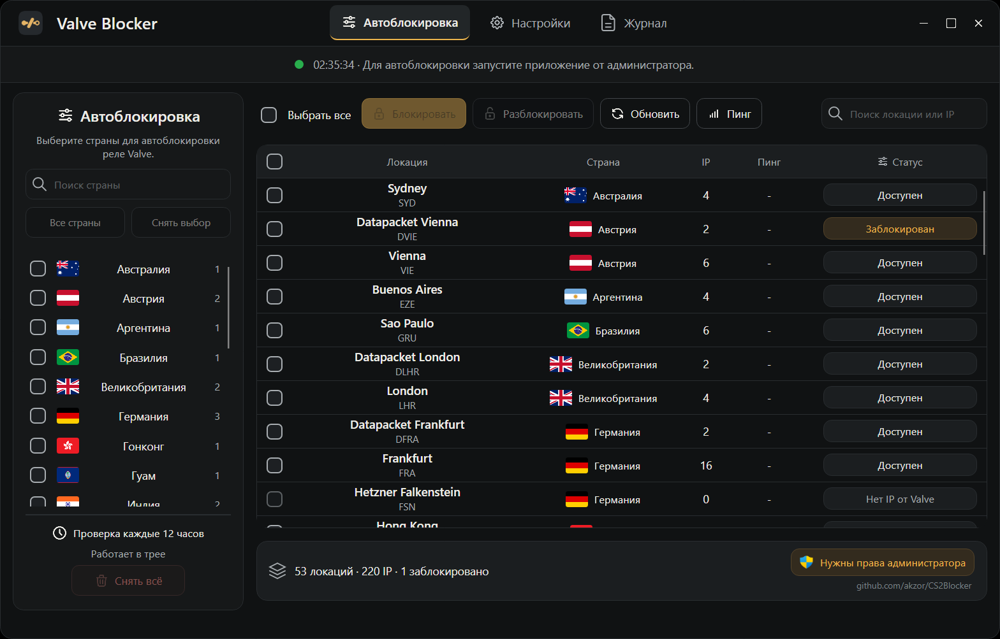

<div align="center">
  
  <h1>Valve Blocker</h1>
  <p>Блокировка реле CS2 по странам и локациям.</p>
  <p>
    
    
    
  </p>
  <p><a href="https://github.com/akzor/CS2Blocker/releases/latest"><strong>Скачать для Windows</strong></a> · <a href="https://github.com/akzor/CS2Blocker/releases">Что нового</a> · <a href="#сборка-из-исходников">Сборка</a></p>
</div>



---

Приложение берёт список реле у Valve и блокирует IP через брандмауэр Windows. Готовый `.exe` работает без установки .NET.

## Быстрый старт

1. Скачай `CS2Blocker.exe` из [последнего релиза](https://github.com/akzor/CS2Blocker/releases/latest).
2. Нажми **«Нужны права администратора»** внизу окна и подтверди запрос Windows.
3. Отметь нужные страны в **«Автоблокировке»** и нажми **«Применить»**. Кнопка **«Все страны»** отмечает весь список.

Чтобы заблокировать отдельные локации, отметь их в таблице и нажми **«Блокировать»**. Локацию можно найти по названию, коду или IP. Меню **«Статус»** фильтрует таблицу вместе с поиском. Кнопка **«Пинг»** проверяет задержку, а **«Журнал»** показывает последние события.

### Как снять блокировку

- Для отдельных локаций нажми **«Разблокировать»**.
- Для автоблокировки стран нажми **«Снять выбор»**, затем **«Применить»**. Ручные блокировки останутся.
- Кнопка **«Снять всё»** удаляет все правила приложения `CS2_Block_*` и отключает автоблокировку.

Закрытие приложения не снимает блокировки.

## Трей и обновления

Крестик по умолчанию сворачивает окно в трей. Для полного закрытия выбери **«Выход»** в меню значка. Сворачивание и запуск вместе с Windows можно настроить отдельно.

Приложение обновляет список Valve каждые 12 часов, в том числе в трее. Для автоблокировки новых IP держи приложение запущенным с правами администратора.

Начиная с 0.2.0 приложение ищет новые версии на GitHub при запуске и каждые 15 минут. Перед установкой оно сверяет SHA-256 файла. Ручная проверка доступна в настройках. С версии 0.1.0 нужно перейти вручную, скачав свежий `.exe`.

Настройки и кеш списка лежат в `%LOCALAPPDATA%\CS2Blocker\settings.json`.

## Сборка из исходников

Нужны Windows x64 и .NET SDK 8 или новее.

```powershell
git clone https://github.com/akzor/CS2Blocker.git
cd CS2Blocker
dotnet publish CS2Blocker/CS2Blocker.csproj -c Release -o release
```

Готовый файл находится в `release/CS2Blocker.exe`.

## Ресурсы

- Интерфейс на [Avalonia](https://github.com/AvaloniaUI/Avalonia).
- Иконки из [Tabler Icons](https://github.com/tabler/tabler-icons) по [лицензии MIT](CS2Blocker/Assets/icons/LICENSE.txt).
- Лицензии шрифтов в [Assets/fonts](CS2Blocker/Assets/fonts).
- Флаги из [Flagpedia](https://flagpedia.net/).
- Значок прав администратора из Windows.
- Изображение Counter-Strike 2 принадлежит Valve. [Steam](https://steamcommunity.com/app/730)

Неофициальная утилита, не связанная с Valve.
